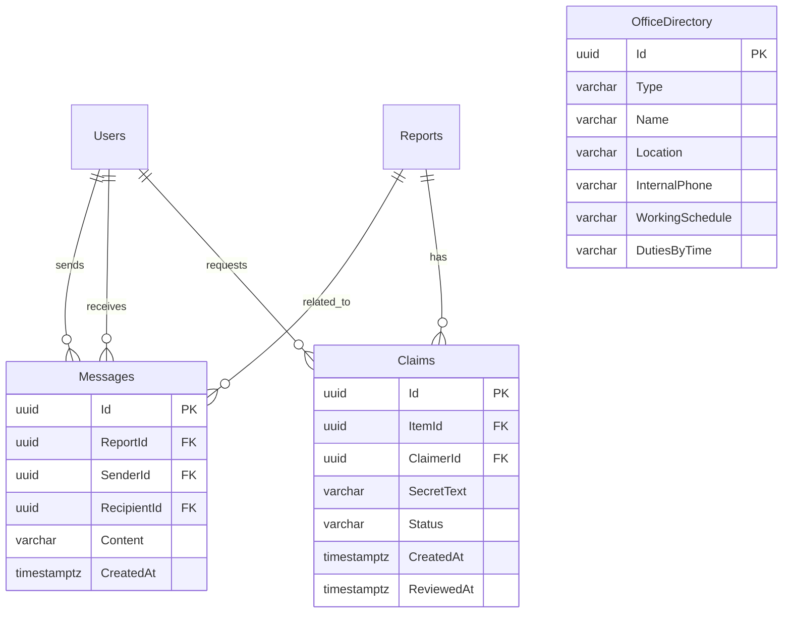

# ERD bổ sung — Sprint 2 / Sprint 3

Các bảng được **bổ sung** vào CSDL Sprint 1 (`Users`, `Reports`, ...); `Reports` chính là bài đăng/vật phẩm trong repo này, **không tạo bảng Items giả**.

## Ràng buộc cốt lõi

- `Claims(ItemId, ClaimerId)` **UNIQUE**: một người chỉ xin nhận một lần trên mỗi bài.
- Chỉ số duy nhất có điều kiện `Claims(ItemId) WHERE Status = 'APPROVED'`: cùng một món đồ không thể duyệt 2 người, kể cả hai request đồng thời.
- Khi duyệt, giao dịch PostgreSQL khóa hàng `Reports` bằng `FOR UPDATE`, cập nhật claim được duyệt và **từ chối tự động các claim đang PENDING khác** trước khi commit.
- `SecretText` **không xuất hiện** trong phản hồi tạo claim, danh sách claim của chính người yêu cầu, hoặc thông tin trả về cho bên không phải chủ bài.
- `Messages` dùng 3 FK: bài đăng, người gửi, người nhận; chỉ chấp nhận luồng **chủ bài ↔ người quan tâm**. Bộ lọc chống chia sẻ email/SĐT trong nội dung chỉ là bảo vệ cơ bản, không thay thế kiểm duyệt thực tế.
- `OfficeDirectory.InternalPhone` chỉ chứa máy lẻ **nội bộ** do đơn vị xác nhận; bản ghi seed có hậu tố `(demo)` và không phải thông tin chính thức của trường.

## Cách áp dụng schema

Tệp chạy lúc khởi động được nhúng vào Backend: `backend/Data/Migrations/sprint23.sql`. Tệp `database/04_sprint23_upgrade.sql` là **bản sao y hệt** để chạy/đối chiếu bằng DBeaver. Có thể chạy nhiều lần; không DROP bảng Sprint 1. Sao lưu DB trước nâng cấp dữ liệu quan trọng.
