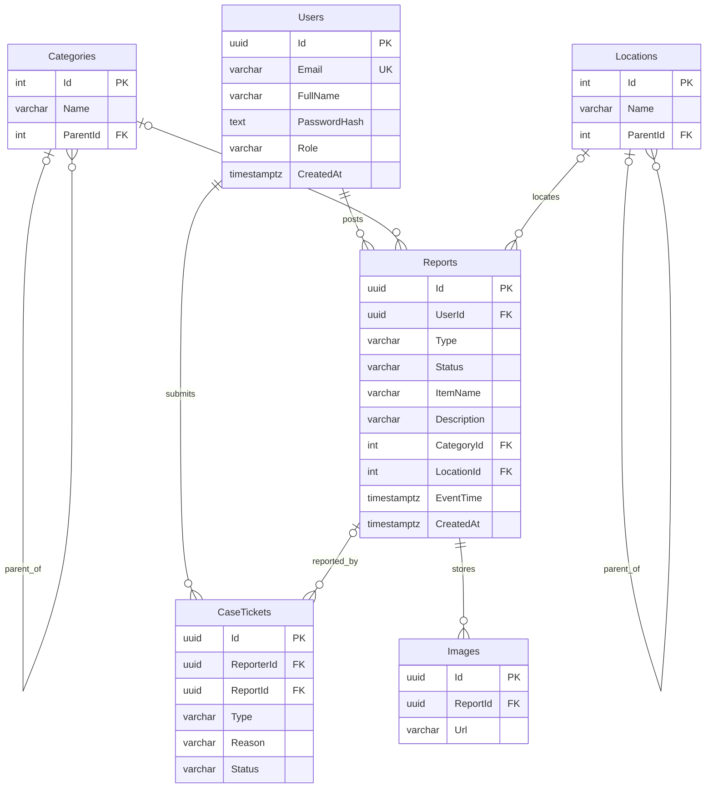

# ERD – Foundly Sprint 1 (Issue #1)

## Lý do thiết kế 3NF

- **Users**: `Id` quyết định các thuộc tính tài khoản; `Email` có chỉ mục UNIQUE.
- **Categories / Locations**: tên danh mục và tên khu vực không được lặp trong `Reports`; tham chiếu bằng `CategoryId`, `LocationId`.
- **Reports**: mỗi thuộc tính mô tả một bài đăng và phụ thuộc khóa `Id`; hình ảnh được tách sang `Images` để tránh một ô chứa nhiều URL.
- **CaseTickets**: thông tin phản ánh được tách riêng khỏi bài đăng và người dùng, có khóa ngoại người báo và bài bị báo cáo.
- **Images**: mỗi ảnh có khóa `Id` và một tham chiếu `ReportId`; không đặt danh sách ảnh trong `Reports`.
- Không có trường phi khóa lưu giá trị phụ thuộc bắc cầu vào một trường phi khóa khác trong các bảng thiết kế. Việc dữ liệu thực tế đạt 3NF vẫn phụ thuộc các ràng buộc/nghiệp vụ tiếp theo.

**Đối chiếu với Issue #1:** `Reports` là **Bài đăng**, `Images` là ảnh của mục đồ; các chức năng "báo cáo vi phạm"/"xác minh bàn giao" của Final chưa đưa vào Sprint 1. ERD ở đây là **phạm vi Sprint 1**, không phải ERD toàn hệ thống Final.

**Ngữ nghĩa trong source Final:** `Reports` tương ứng **Bài đăng** chứa thông tin **Mục đồ** (không có bảng Items độc lập); `CaseTickets` là **Báo cáo/phản ánh**. Đây là bản lược đồ giữ gần mô hình Final, không giả lập hai bảng Mục và Bài đăng riêng biệt.
